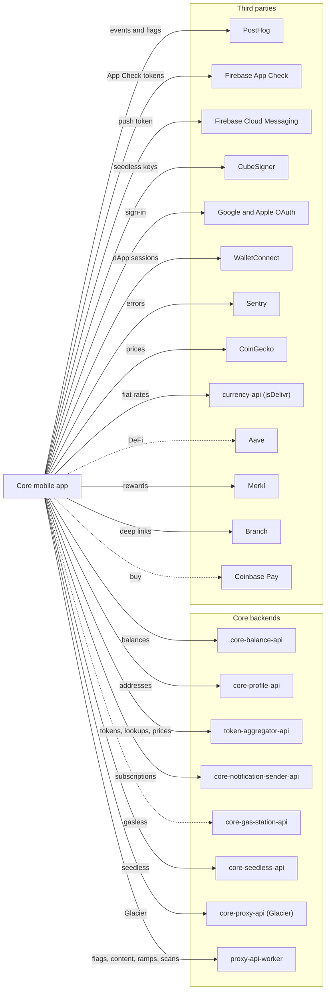

# Overview

Core mobile is the Core wallet app for iOS and Android. The app is named AvaxWallet in the stores. It supports Avalanche, EVM, Bitcoin and Solana through VM modules, and connects to dApps through WalletConnect.

## Stack

- React Native 0.86.3, React 19.2.3, Expo SDK 57 (dev client, expo-router), React Compiler and Nitro native modules.
- State: Redux Toolkit with encrypted redux-persist, TanStack React Query (persisted), and Zustand in swap.
- Yarn 3.6.4 workspaces monorepo. Nothing in the monorepo is published to npm.

## Repository layout

| Path                     | Contents                                                                                       |
| ------------------------ | ---------------------------------------------------------------------------------------------- |
| `packages/core-mobile`   | The wallet app. Legacy code in `app/` (store, services, hooks, `vmModule`) and new code in `app/new/`. |
| `packages/k2-alpine`     | Private design system and Storybook.                                                           |
| `packages/eslint-mobile` | Shared ESLint plugin, `eslint-plugin-avalabs-mobile`.                                          |
| `packages/tsconfig-mobile` | Shared TypeScript config.                                                                    |
| `bitrise.yml`            | Bitrise build, signing and test workflows.                                                     |
| `.github/workflows`      | PR checks, coverage report, CodeQL and the Bitrise env sync.                                   |

## Architecture

Dotted edges are behind feature flags. Some SDKs call endpoints that are not listed here, such as `@avalabs/fusion-sdk` for swaps and bridges.

## Backend dependencies

Each base URL is an env var. Production values come from CI secrets, not from the repository.

| Service                        | Env var                           | Used for                                                                                                 | Auth                                              |
| ------------------------------ | --------------------------------- | -------------------------------------------------------------------------------------------------------- | ------------------------------------------------- |
| `core-balance-api`             | `BALANCE_URL`                     | Balances (`POST /v1/balance/get-balances`) and supported chains (`GET /v1/balance/get-supported-chains`) | App Check                                         |
| `core-profile-api`             | `CORE_PROFILE_URL`                | Address derivation from xpub (`POST /v1/get-addresses`)                                                  | App Check                                         |
| `token-aggregator-api`         | `TOKEN_AGGREGATOR_URL`            | Token lists and lookups (`/v2/tokens`, `/v1/token/lookup`, `/v1/token/lookupWithPrice`), watchlist and trending (`/v1/watchlist/*`) | App Check                  |
| `core-notification-sender-api` | `NOTIFICATION_SENDER_API_URL`     | Push registration, balance, news, price-alert and recurring-swap subscriptions, notification center (`/v1/push/*`) | App Check                        |
| `core-gas-station-api`         | `GAS_STATION_URL`                 | Gasless transactions through `@avalabs/core-gasless-sdk`. Flags `gasless-feature` and `gasless-instant`. | App Check header set on the SDK          |
| `core-seedless-api`            | `SEEDLESS_URL`, `SEEDLESS_API_KEY` | Seedless registration, account add and key derivation (`/v1/register`, `/v1/addAccount`, `/v1/deriveMissingKeys`) | API key in `Authorization`. Without the key the seedless service is a no-op. |
| `proxy-api-worker`             | `PROXY_URL`                       | `GET /networks`; DeBank (`/proxy/debank/v1/...`); CoinGecko (`/proxy/coingecko/...`, also the 429 fallback); Blockaid (`/proxy/blockaid`); Contentful (`/proxy/contentful`); Meld (`/proxy/meld/...`, `/proxy/meld-sandbox/...`); Markr (`/proxy/markr-helium/info/partner`); Hashflow (`/proxy/hashflow`); PostHog flags (`/proxy/posthog/decide`); MoonPay (`/moonpay/:address`); perps geo check (`/perps/available`) | None sent by the app |
| `core-proxy-api`               | `GLACIER_URL`                     | Glacier calls through `/v1/proxy/glacier`: chains, NFTs, validators, transactions and Earn              | App Check, plus `x-core-api-key` when `CORE_API_KEY` is set |

The App Check token is sent as `X-Firebase-AppCheck`. The generated API clients and the Glacier SDK also send `x-application-name` (`core-mobile-ios` or `core-mobile-android`) and `x-application-version`.

## Third parties

| Third party                  | Used for                                                                               |
| ---------------------------- | -------------------------------------------------------------------------------------- |
| PostHog                      | Analytics, sent only when the user enables it, and feature flags. Flags come from `proxy-api-worker` first, then PostHog directly. |
| Firebase App Check           | App attestation: Play Integrity on Android, App Attest with DeviceCheck fallback on Apple. |
| Firebase Cloud Messaging     | Push token, shown through Notifee. The token is registered with `core-notification-sender-api`. |
| CubeSigner                   | Seedless key operations, MFA (TOTP and FIDO) and passkeys.                            |
| Google and Apple OAuth       | Sign-in for seedless.                                                                  |
| WalletConnect                | dApp sessions through `@reown/walletkit`.                                              |
| Sentry                       | Error reporting. Events are scrubbed. Off in E2E builds.                               |
| CoinGecko                    | Free-tier prices called directly. A 429 falls back to the paid route on `proxy-api-worker`. |
| currency-api (jsDelivr)      | Fiat rates. Fallback: `latest.currency-api.pages.dev`.                                 |
| Aave                         | DeFi market data and Merit APRs. Flag `in-app-defi`.                                   |
| Merkl                        | User rewards.                                                                          |
| Branch                       | Deep links through `react-native-branch`.                                              |
| Coinbase Pay                 | On-ramp URL generation for the buy flow. Flag `buy-feature-coinbase`.                 |

Ledger devices connect over Bluetooth LE through `@ledgerhq/device-management-kit`. NFT media resolves through IPFS.

## Feature flags

Flags are fetched through `proxy-api-worker` and refreshed every 30 seconds. E2E builds skip version-range checks.

- Ramps and dApp safety: `meld-onramp`, `meld-offramp`, `enable-meld-sandbox`, `blockaid-dapp-scan`
- Trading and DeFi: `gasless-feature`, `gasless-instant`, `perpetuals`, `predictions`, `fusion*`, `swap-recurring`, `in-app-defi`, `earn-feature`, `buy-feature-coinbase`
- Seedless and notifications: `seedless-*`, `all-notifications`, `enable-notification-prompt`
- Platform: `ledger-support`, `solana-support`, `injected-provider`, `in-app-update-android`, `in-app-review`, `log-errors-to-sentry`

## More documentation

- Core-mobile docs in the repository:
  - [App signing](https://github.com/ava-labs/core-mobile/blob/main/packages/core-mobile/docs/app_signing.md)
  - [CI Android build caching](https://github.com/ava-labs/core-mobile/blob/main/packages/core-mobile/docs/ci_android_build_caching.md)
  - [Encryption key storage](https://github.com/ava-labs/core-mobile/blob/main/packages/core-mobile/docs/encryption_key_storage.md)
  - [Features](https://github.com/ava-labs/core-mobile/blob/main/packages/core-mobile/docs/features.md)
  - [Patches](https://github.com/ava-labs/core-mobile/blob/main/packages/core-mobile/docs/patches.md)
  - [Performance testing](https://github.com/ava-labs/core-mobile/blob/main/packages/core-mobile/docs/performance_testing.md)
  - [Release process](https://github.com/ava-labs/core-mobile/blob/main/packages/core-mobile/docs/release_process.md)
  - [Styles](https://github.com/ava-labs/core-mobile/blob/main/packages/core-mobile/docs/styles.md)
  - [Toast behaviour](https://github.com/ava-labs/core-mobile/blob/main/packages/core-mobile/docs/TOAST_BEHAVIOR.md)
  - [Token aggregator](https://github.com/ava-labs/core-mobile/blob/main/packages/core-mobile/docs/token-aggregator.md)
  - [Token refresh flow](https://github.com/ava-labs/core-mobile/blob/main/packages/core-mobile/docs/token_refresh_flow.md)
  - [App README](https://github.com/ava-labs/core-mobile/blob/main/packages/core-mobile/README.md), [CLAUDE.md](https://github.com/ava-labs/core-mobile/blob/main/packages/core-mobile/CLAUDE.md) and [best practices](https://github.com/ava-labs/core-mobile/blob/main/packages/core-mobile/BEST_PRACTICES.md)
- [E2E README](https://github.com/ava-labs/core-mobile/blob/main/packages/core-mobile/e2e/README.md)
- [Development](development.md)
- [Release](release.md)
- [Ledger flows](ledger-flows/README.md)
- [Injected provider demo](injected-provider/working_demo.md)
- [Dependency resolutions](dependencies_resolutions.md)
