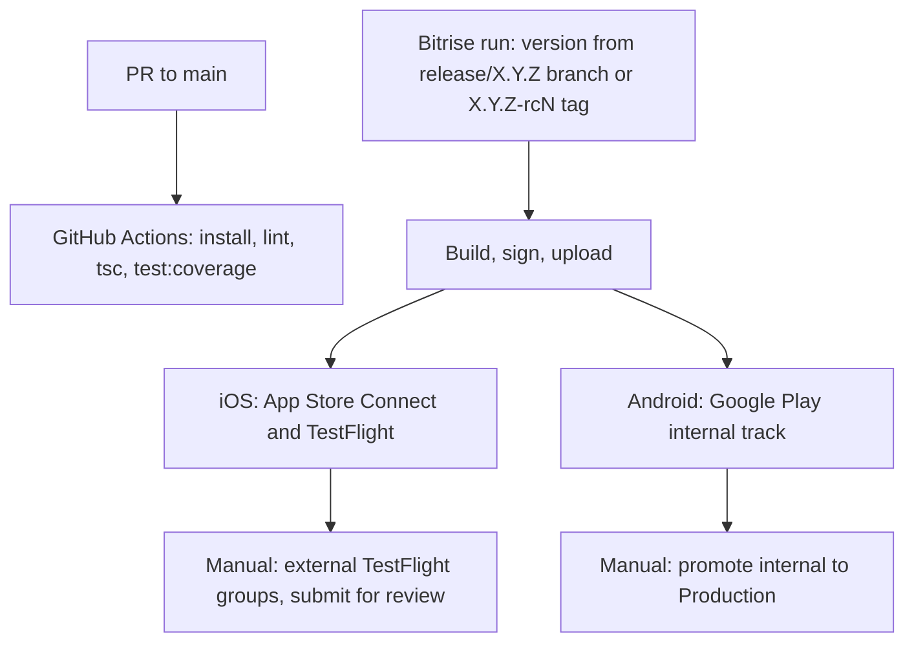

# Release

## Pipeline

Bitrise builds, signs and uploads the iOS and Android apps. Releases reach users through the stores only. The app has no over-the-air updates.

Triggers for Bitrise builds are set in the Bitrise UI. `bitrise.yml` does not define them.

## Versioning

- The version comes from the branch or tag. A `release/X.Y.Z` branch or an `X.Y.Z-rcN` tag gives `X.Y.Z`. Other refs give `0.0.0` (`packages/core-mobile/scripts/bitrise/getAppVersion.sh`).
- The repository keeps placeholder version values.
- On iOS the build number is `$BITRISE_BUILD_NUMBER`. On Android it is computed in `packages/core-mobile/scripts/bitrise/getBuildNumber.sh`.

## Workflows

| Workflow                           | Purpose                                                 |
| ---------------------------------- | ------------------------------------------------------- |
| `android`                          | External release build for Google Play.                 |
| `android-internal`                 | Internal release build.                                 |
| `ios`                              | Release build, scheme `AvaxWallet`.                     |
| `ios-internal`                     | Internal build, scheme `AvaxWalletInternal`.            |
| `*-internal-e2e`                   | Internal builds for E2E runs.                           |
| `aws-{android,ios}-regression-test` | Appium regression tests on AWS Device Farm.            |
| `aws-{android,ios}-seedless-transactions-test` | Appium seedless transaction tests on AWS Device Farm. |

## Build environment

- Env files and Google services files are in AWS Secrets Manager under `core/dev/mobile/.env.*`.
- The manual GitHub workflow `bitrise-envs-sync.yml` pushes them to Bitrise.
- `packages/core-mobile/scripts/bitrise/setEnv.sh` copies `.env.{production|internal}[.e2e]` to `.env`. It also picks the internal or external Google services files.

## Checks on pull requests

GitHub Actions runs `mobile-pr.yml` on PRs to `main`. It runs `yarn install --immutable`, `yarn setup` with `APP_ENV=ci`, `yarn lint --quiet`, `yarn tsc` and `yarn test:coverage`. `mobile-pr-coverage-report.yml` and `codeql-analysis.yml` also run. E2E runs only on Bitrise.

## Store steps

Manual store steps: see [release process](https://github.com/ava-labs/core-mobile/blob/main/packages/core-mobile/docs/release_process.md).
